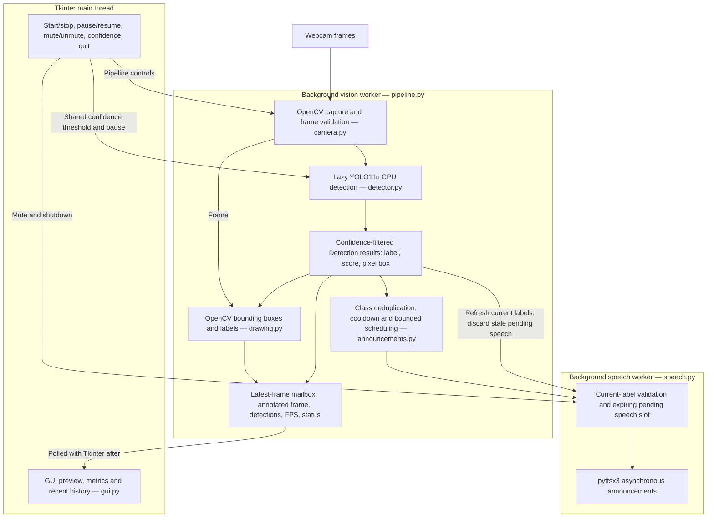
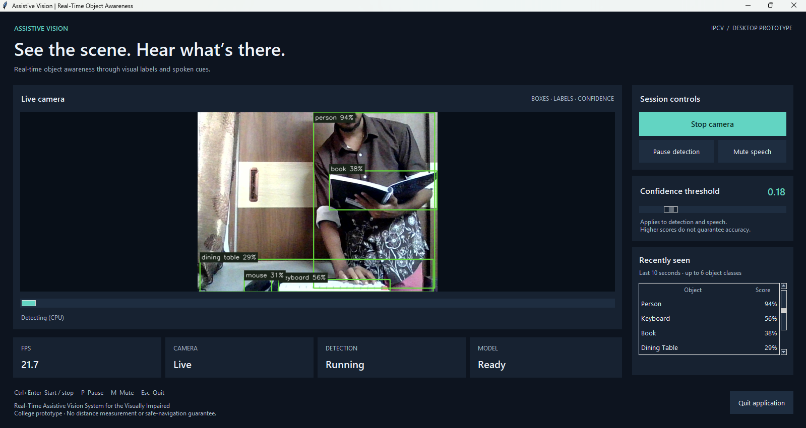
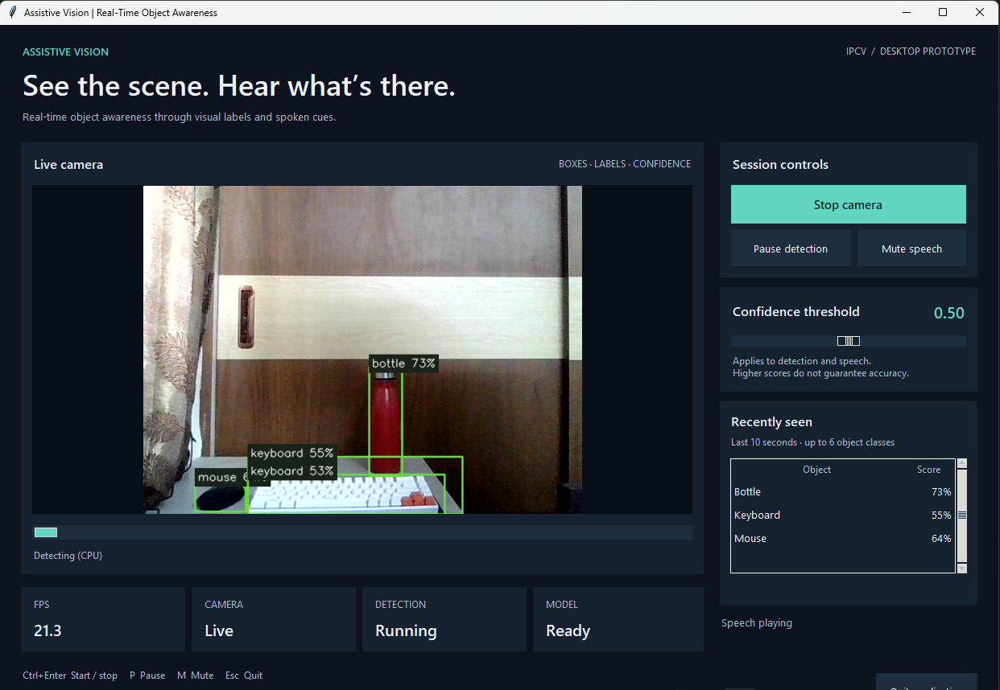
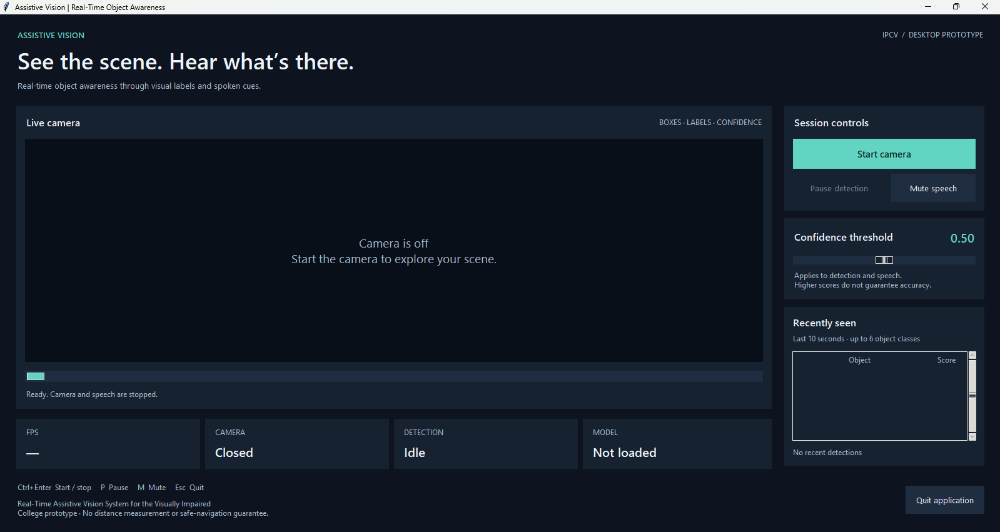

# Real-Time Assistive Vision System for the Visually Impaired

An Image Processing and Computer Vision (IPCV) university project that uses a
webcam to recognize common objects, display labeled bounding boxes, and provide
short spoken announcements through a Windows desktop application.

**Current status:** Phase 3 implementation complete; Phase 5A documentation polish.
The application uses pretrained YOLO11n weights with CPU inference. It is an
assistive awareness prototype, not a certified navigation or safety device.

## Problem statement

Visual information about surrounding objects can be difficult to access for
people with visual impairments. This project explores how a live camera and
pretrained object detector can convert some of that information into concise
audio feedback, while providing a visual interface for demonstration and testing.

## Objectives

- Capture and process live webcam frames.
- Recognize supported object classes and display their labels, confidence scores,
  and bounding boxes.
- Announce eligible classes without continuously repeating the same objects.
- Keep the interface responsive during capture, inference, and speech.
- Provide clear controls and useful feedback when a device or dependency fails.
- Keep the implementation modular, testable, and understandable for a university viva.

## Key features

- Dark Tkinter/ttk dashboard with a resizable, aspect-preserving camera preview.
- Pretrained YOLO11n detection with a shared detection/speech confidence threshold.
- Asynchronous offline speech, using phrases such as “Chair detected.”
- Fair, bounded class scheduling; cooldowns and stale pending-announcement removal.
- Start/stop camera, pause/resume detection, mute/unmute speech, and clean exit.
- Processing FPS, camera/detection/model status, and speech status.
- Recent history of up to six classes seen within the last ten seconds.
- Keyboard controls and rate-limited optional diagnostics.
- An alternative OpenCV preview using the same processing pipeline.

## Technology stack

| Component | Technology and role |
| --- | --- |
| Language | Python 3.11; development environment uses Python 3.11.9 |
| Camera and drawing | OpenCV (`opencv-python`): capture, frames, boxes, and labels |
| Object detection | Ultralytics with pretrained YOLO11n; CPU execution |
| Desktop interface | Python standard-library Tkinter and ttk |
| Preview image bridge | Pillow: conversion/resizing for Tkinter display |
| Text-to-speech | pyttsx3; Windows SAPI speech with a persistent event loop |
| Automated testing | pytest, with mocks for model, camera, and audio adapters |

The declared dependencies and version ranges are in `requirements.txt`.
Ultralytics installs PyTorch and other transitive dependencies, so environment
installation is substantially larger than the nano model weights. No custom
training, paid API, database, Docker, or cloud inference is used.

## System architecture



Capture, inference, and drawing execute on one vision worker. Speech owns its
engine on a separate worker. Only the latest processed frame is retained for
the GUI; Tkinter widget updates run on the main thread. The desktop controller
reuses one pipeline and waits for cleanup before permitting a new camera session.

Speech scheduling observes every processed detection frame, even while speech
is busy. It queues up to six eligible classes in arrival order and submits one
class phrase at a time. A continuously visible class is announced once per
appearance. Reappearance requires at least one second of absence and also
respects an eight-second per-class cooldown. Missing or below-threshold classes
leave the waiting queue; pending speech expires after two seconds from its
source-frame observation. Pause, mute, and empty detection results clear pending
speech context. An utterance already handed to the audio engine may finish.

Labels are preserved from detector results through drawing and speech. Multiple
instances of one class produce one class announcement; the system does not
track individual object identities. Recent GUI history never drives speech.

### Project structure

| Path | Responsibility |
| --- | --- |
| `assistive_vision/__main__.py` | Shared GUI/OpenCV command-line launcher |
| `assistive_vision/detections.py` | Validated, immutable detection data |
| `assistive_vision/camera.py` | Camera opening, reading, and release |
| `assistive_vision/detector.py` | Lazy model loading and result conversion/filtering |
| `assistive_vision/drawing.py` | Bounding boxes, class labels, and confidence overlays |
| `assistive_vision/announcements.py` | Confidence policy, cooldowns, and fair class scheduling |
| `assistive_vision/speech.py` | Speech worker, freshness checks, and Windows event pump |
| `assistive_vision/pipeline.py` | Background processing, control handoff, and latest result |
| `assistive_vision/desktop_logic.py` | Session controls, preview sizing, and bounded history |
| `assistive_vision/gui.py` | Tkinter/ttk dashboard |
| `assistive_vision/diagnostics.py` | Rate-limited diagnostic summaries |
| `tests/` | Hardware-independent automated tests |
| `requirements.txt` | Runtime and test dependencies |

## Windows installation and setup

### Prerequisites

- Windows with Python 3.11 installed, including Tcl/Tk support.
- A working webcam and camera permission for desktop applications.
- Speakers or headphones, a working output device, and an installed Windows speech voice.
- Internet access for dependency installation and the first weight download,
  unless the environment and model weights are already available locally.

Use **PowerShell** and run commands from the repository root, where
`requirements.txt` and `assistive_vision/` are located. The current development
checkout is shown below; change the path if your copy is elsewhere.

```powershell
Set-Location "H:\IPCV\New folder\assistive-vision-system"
python --version
if (-not (Test-Path .venv)) { python -m venv .venv }
.\.venv\Scripts\python.exe -m pip install -r requirements.txt
```

Confirm that `python --version` reports Python 3.11 before creating the environment.
Reuse an existing Python 3.11 `.venv`. These commands install dependencies locally;
activation and global package installation are unnecessary. Tkinter is supplied
by the Windows Python installer, rather than this requirements file.

### Launch the desktop application

```powershell
.\.venv\Scripts\python.exe -m assistive_vision --gui
```

The GUI opens with the camera off. Select **Start camera** to begin capture and
detection. YOLO11n loads on the first unpaused detection. If `yolo11n.pt` is
missing, Ultralytics attempts to download it. Wait for model readiness before
expecting detections; unit tests do not perform this download.

With existing local weights, use:

```powershell
.\.venv\Scripts\python.exe -m assistive_vision --gui --weights .\yolo11n.pt
```

Run from this folder to keep downloaded weights in the project. Model files
are ignored by Git and are not guaranteed to be included in a fresh checkout.
Ultralytics configuration defaults to ignored `.local/ultralytics`, unless a
`YOLO_CONFIG_DIR` environment variable is already set. After installation and
with local weights and a working speech voice, inference and speech operate offline.

### Launch options

| Option | Behavior |
| --- | --- |
| `--gui` | Open the Tkinter dashboard; omission uses the OpenCV preview |
| `--camera 1` | Choose camera index 1; default is 0 |
| `--weights .\yolo11n.pt` | Supply an existing pretrained detection weight file |
| `--confidence 0.5` | Set the detector and announcement threshold; default 0.5, range 0–1 |
| `--mute` | Start with speech muted |
| `--debug` | Print at most one diagnostic summary per second |
| `--help` | Display the supported command-line options |

For example:

```powershell
.\.venv\Scripts\python.exe -m assistive_vision --gui --debug --confidence 0.5
.\.venv\Scripts\python.exe -m assistive_vision --gui --camera 1 --mute
```

## Operating the application

| Control | Action |
| --- | --- |
| Start camera / Stop camera | Start processing or release the camera and stop speech workers |
| Pause detection / Resume detection | Suspend or resume detection while the camera preview continues |
| Mute speech / Unmute speech | Disable or enable announcements; pending speech is discarded on mute |
| Confidence slider | Change the shared detection/speech threshold on a subsequent processing frame |
| Quit application / window close | Request worker cleanup and close the application |

The GUI exposes camera, detection, model, and speech states separately from the
preview. FPS is measured processing throughput, not the camera's nominal frame
rate or a guaranteed GUI refresh rate. The recent list is history, so it can
contain a class that is no longer visible in the current frame.

Use Tab/Shift+Tab to navigate controls. Ctrl+Enter starts/stops the camera,
P pauses/resumes detection, M mutes/unmutes, and Escape or Ctrl+Q quits.
Left/Right changes a focused confidence slider by 0.01. The window has a minimum
size of 1000 × 860; allow enough display space for the controls.

Stop/quit does not forcibly interrupt native camera or inference calls. Cleanup
may wait for those calls or an active speech utterance to return. The GUI polls
worker state during shutdown instead of blocking its main thread.

For the alternative OpenCV preview:

```powershell
.\.venv\Scripts\python.exe -m assistive_vision
```

It starts the camera automatically. With that preview focused, P pauses/resumes,
M mutes/unmutes, and Q or Escape quits. Closing the preview or pressing Ctrl+C
in the terminal also requests shutdown.

## Testing and verification

Run the complete existing suite from the repository root:

```powershell
.\.venv\Scripts\python.exe -m pytest -q
```

**Latest automated result, 10 October 2026: 142 passed.** The suite was rerun
during this documentation phase. The launcher options were also checked with
`python -m assistive_vision --help` using the local virtual environment.

Tests cover detection validation, label/score/box preservation, confidence
filtering, cooldowns, fair multi-class scheduling, persistence and reappearance,
stale pending speech, mute behavior, mocked adapter failures, worker cleanup,
Windows speech-loop behavior, and UI-independent desktop logic. They use mocks
and require no physical camera, real speaker, or model-weight download. Passing
tests do not measure detection accuracy, prove audible output, or certify safety.

The project developer reports successful manual testing of the GUI, live webcam
detection, speech announcements, mute/unmute, pause/resume, stop, and clean exit.
These are functional checks on the tested setup, not evidence of compatibility
with every Windows device. No new hardware testing was performed in Phase 5A.

Before a submission demo, confirm those functions on the presentation machine.
Also check first-use model loading, an unavailable camera, confidence changes,
repeated start/stop, resizing and keyboard focus. These additional checks are
recommended; they are not all claimed as manually verified here.

## Troubleshooting

| Symptom | Suggested action |
| --- | --- |
| Camera cannot open | Enable desktop-app camera access in Windows settings, close competing camera apps, or try another `--camera` index |
| Model loading fails | Check the reported error, installation, first-download internet access, or the path supplied with `--weights` |
| Speech is unavailable | Check output device/volume and installed Windows voices; video can continue after a speech failure |
| Imports fail | Install `requirements.txt` using `.venv\Scripts\python.exe`; confirm you launch with that interpreter |
| Unexpected label or announcement | Compare the current bounding box and score with `--debug` output before changing the threshold |

Debug summaries include sampled current classes/confidence, FPS, frame age,
and speech state. The last speech request is historical and is not proof that
an object remains visible or that audio was heard. Debug mode does not log every
frame. Normal operation is quiet apart from warnings/errors; Ultralytics may
still print first-download progress.

## Known limitations

- Pretrained YOLO11n recognizes a fixed set of 80 classes. It can miss objects,
  produce false positives, or misclassify them under unfamiliar conditions.
- **There is no dedicated pen class.** A pen may be missed or misclassified as
  a supported class such as `cell phone`. That reported case was not reproduced
  in the earlier 25-frame local check, so no pen-specific score or box is established.
- Confidence is a model score, not proof of correctness. Increasing the threshold
  can remove useful detections and does not guarantee correct classification.
- Lighting, occlusion, object size, camera angle, motion, and CPU performance affect
  results. Inference currently uses CPU and a 416-pixel model input size.
- Classes, rather than individual objects, are announced. This is not object
  tracking, scene understanding, or a complete obstacle-detection system.
- The system does not estimate exact distances, identify safe paths, or guarantee
  safe navigation. It must not replace mobility aids or professional guidance.
- Pending speech is bounded and stale labels are discarded, but camera buffering,
  inference latency, and an already-started utterance can delay feedback.
- The dashboard offers keyboard access and spoken object feedback; comprehensive
  screen-reader accessibility and studies with visually impaired users have not
  been established.
- Dependency ranges are not a fully locked environment, and performance has not
  been benchmarked across different machines.

## Future improvements

The following are proposals, not implemented features:

- Evaluate detection accuracy and latency using documented scenes and repeatable measurements.
- Improve usability and screen-reader accessibility through user feedback and testing.
- Assess speech pacing and prioritization in crowded scenes.
- Explore tracking to distinguish individual instances and reduce detection flicker.
- Expand supported object recognition only after evaluating the existing model's limitations.
- Investigate calibrated depth sensing for distance information as a separate extension.

## Demo Screenshots



Live dashboard showing model-returned labels, confidence scores, session controls,
and recent detections. This example uses a confidence threshold of 0.18.



Object detection at a 0.50 threshold, with bounding boxes and confidence scores
for a bottle, keyboard, and mouse, alongside processing and speech status.



Idle state before starting the camera: detection is idle, the model is not loaded,
and the recent-detections list is empty.

## Submission evidence

The real application screenshots above illustrate the interface and sample model
output; they are not accuracy benchmarks or proof of audible speech. A recorded
demo, test-machine specifications, and measured performance remain to be added
when available.
